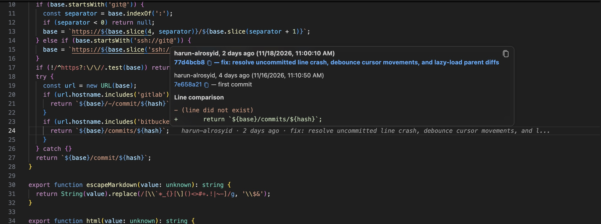

# Git Line History

Small VS Code extension that shows Git history for the line under the cursor.



## Table of contents

- [Features](#features)
- [Command Palette](#command-palette)
- [Architecture](#architecture)
- [Requirements](#requirements)
- [Install from source](#install-from-source)
- [Build a VSIX](#build-a-vsix)
- [Configuration](#configuration)
- [Limitations](#limitations)

## Features

- Shows a muted inline summary with the author, date, and commit message.
- Opens commit details when hovering the inline summary.
- Displays the current commit in bold, plus its first parent when available.
- Shows the parent and current line as a red/green diff code block.
- Copies the current or parent commit hash with the copy icon.
- Links commits through the repository `origin` remote when it is supported.
- Formats dates with the optional `gitLineHistory.dateLocale` setting.
- Disables inline blame on uncommitted or edited lines by default for better performance and a distraction-free editing experience.
- Activates only in workspaces containing a Git repository.
- Does not add a panel, status-bar item, GitHub connection, or settings icon.

## Command Palette

- `Git Line History: Reload Extension`: restarts the extension host without reloading the whole window.
- `Git Line History: Copy Commit Hash`: copies the current or parent commit hash from the copy icon in a hover.

## Architecture

```text
VS Code editor
    |
    +-- Cursor moves
    |     `-- updateInlineBlame()
    |           `-- lineCommit()
    |                 +-- git blame --line-porcelain
    |                 `-- muted inline decoration
    |
    +-- Hover inline summary
          `-- provideHover()
                `-- lineCommit()
                      +-- git remote get-url origin
                      +-- git show -s --format=%P <commit>
                      +-- git show <parent>:<file>
                      +-- git show -s --format=... <parent>
                      `-- Markdown hover with diff, copy links, remote links
```

`lineCommit()` resolves the repository root, reads blame data for one line, then
loads the first parent and the same line number from that parent. The hover is
rendered as a trusted `MarkdownString` only for the local copy command; commit
metadata is escaped before it is inserted into Markdown or HTML.

### Files

- `src/extension.ts`: extension activation and VS Code event handlers.
- `src/git.ts`: Git command execution and blame parsing.
- `src/format.ts`: commit URLs, Markdown/HTML escaping, and diff formatting.
- `src/styles.ts`: inline decoration styling.
- `test.js`: dependency-free assertions for parsing, diff output, and remote URL conversion.
- `package.json` and `tsconfig.json`: VS Code manifest and TypeScript build configuration.

The extension uses only the VS Code API, Node.js `child_process`, and the installed Git CLI. No runtime dependency or network service is required.

## Requirements

- VS Code `1.146` or newer.
- Git available on `PATH`.
- Opened file belongs to a Git repository.

## Install from source

```sh
npm test
code --extensionDevelopmentPath="$PWD" .
```

`npm test` compiles TypeScript into `out/` before running the assertions.

Reload VS Code after installation if the inline summary does not appear.

Use `Git Line History: Reload Extension` from the Command Palette to restart the extension host without reloading the whole window.

## Build a VSIX

Install the VS Code packaging tool once:

```sh
npm install --global @vscode/vsce
vsce package
code --install-extension git-line-history-0.0.4.vsix
```

The generated `.vsix` file can be shared or uploaded to a release.

## Configuration

- `gitLineHistory.dateFormat`: date format for inline blame (`relative`, `date`, or `datetime`). Default is `relative` (e.g. `2 days ago`).
- `gitLineHistory.dateLocale`: controls date formatting locale. Empty uses the system locale.
- `gitLineHistory.showUncommitted`: controls whether uncommitted or newly edited lines show inline blame. Default is `false` to keep editing fast and distraction-free.

## Limitations

- The previous line uses the same line number in the parent commit; large line moves are not semantically matched.
- Commit links require an HTTP(S) or SSH-style `origin` remote.
- The extension reads local Git history only.
